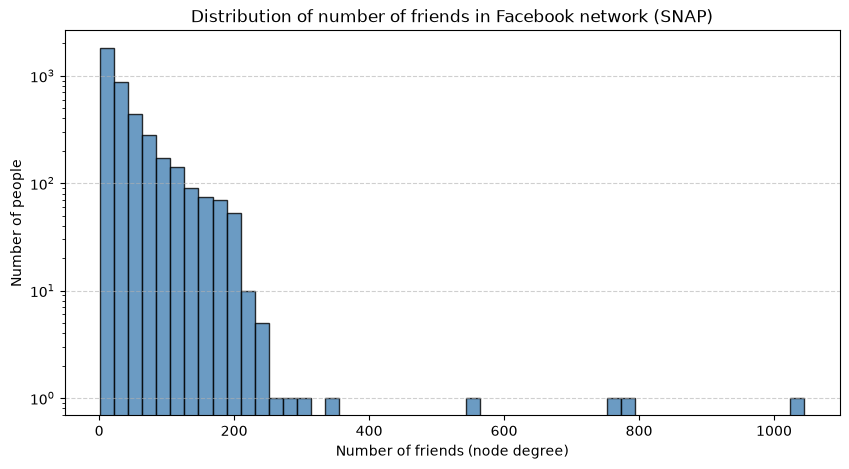
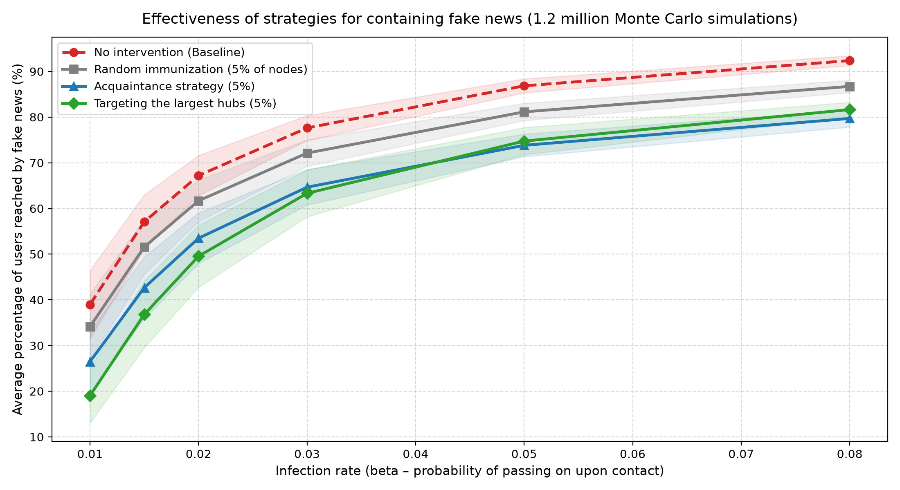
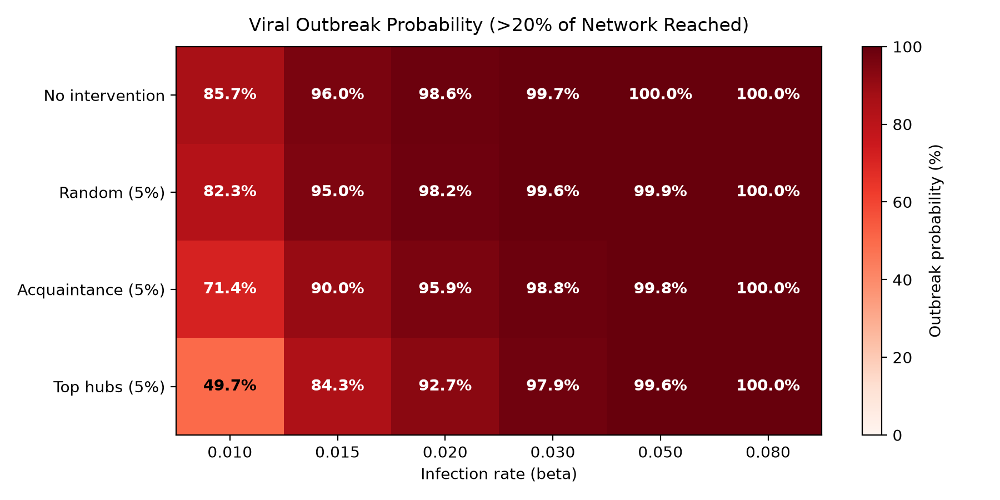
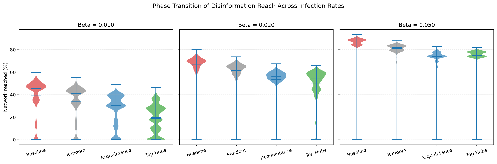
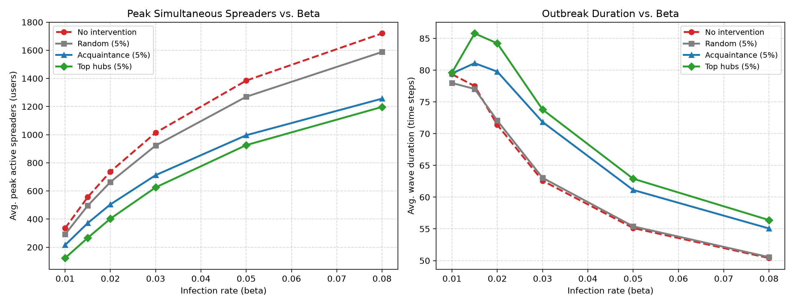
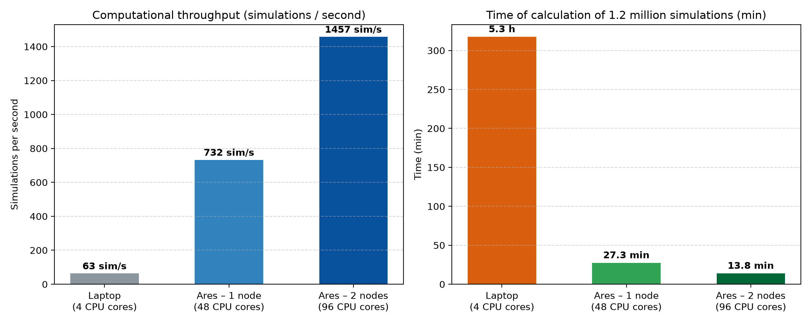

# Viral Disinformation Spread Simulation on HPC


A large-scale Monte Carlo simulation project analyzing how fake news spreads through a real-world social network and evaluating different immunization strategies. To achieve high statistical reliability across **1,200,000 simulation runs**, the workload was parallelized using Python `multiprocessing` and **Slurm Job Arrays** across 2 compute nodes (96 CPU cores) on the **Ares supercomputer** (ACC Cyfronet AGH).


## Overview
Social media networks are heavily connected, which allows viral misinformation to spread rapidly. When platforms detect a false narrative early, they usually have limited moderation or fact-checking resources (enough to warn or "immunize" only a small fraction of users).

## Project Goal
The main goal of this project is to answer two questions:
1. Which immunization strategy is most effective at containing fake news when we can only protect **5%** of the network?
2. How does the contagiousness of a post (`beta`) change the outbreak dynamics, and where is the critical threshold beyond which a viral outbreak becomes unstoppable?


## Dataset Description

The simulation runs on a real, anonymized social graph from the **Stanford Network Analysis Project (SNAP)** - Social circles: Facebook (`facebook_combined.txt`).

- Nodes (Users): 4,039
- Edges (Connections): 88,234 (undirected)
- Source: [SNAP Ego-Facebook Dataset](https://snap.stanford.edu/data/ego-Facebook.html)


## Exploratory Data Analysis (EDA)

Before running the simulations, I analyzed the structural properties of the graph in `notebooks/01_network_eda.ipynb`:

- Average number of friends: 43.69
- Median number of friends: 25
- Largest hub (Node ID `107`): 1,045 connections (followed by nodes `1684` with 792, `1912` with 755, and `3437` with 547 connections)




The network has a strongly right-skewed degree distribution. While a typical user has around 25 connections, a few "super-connectors" (hubs) have hundreds of friends and act as major accelerators for viral content.

## Experiment Setup

To model how fake news spreads and fades away, I implemented a discrete-time **SIR (Susceptible – Spreader – Stifler)** epidemiological model on the graph:

- **Susceptible (`S`):** Users who have not seen the fake news yet.
- **Spreader (`I`):** Users who believed the post and actively share it with their neighbors.
- **Stifler (`R`):** Users who lost interest, saw a fact-check, or were pre-immunized before the outbreak (they do not share the post and cannot be re-infected).

### Simulation Parameters
- **Initial spreaders:** 5 randomly chosen non-immunized users at step `t = 0`.
- **Infection rate (`beta`):** Probability of convincing a neighbor during a single time step. Tested across 6 levels: `0.010`, `0.015`, `0.020`, `0.030`, `0.050`, `0.080`.
- **Recovery rate (`gamma`):** Fixed at `0.20` (20% chance per step that a spreader stops sharing).
- **Immunization budget:** **5% of the network** (~202 users) protected before the rumor starts.

### Tested Containment Strategies
1. **No Intervention (`none`):** Baseline scenario without any protection.
2. **Random Immunization (`random`):** Protects 5% of users chosen uniformly at random.
3. **Acquaintance Immunization (`acquaintance`):** Picks a random user and immunizes one of their random friends (exploiting the *Friendship Paradox* without needing global knowledge of the network).
4. **Top Hubs Targeting (`hubs`):** Protects the top 5% most connected users in the graph.

Each of the 24 scenarios (6 `beta` values × 4 strategies) was simulated 50,000 times, resulting in **1,200,000 independent runs**.

## Results

### Average Reach Across Infection Rates
The table below shows the average percentage of the network reached by fake news across all 1.2 million simulations:

| Infection Rate (`beta`) | No Intervention | Random (5%) | Acquaintance (5%) | Top Hubs (5%) |
| :---: | :---: | :---: | :---: | :---: |
| **0.010** | 38.99% | 34.16% | 26.45% | **19.03%** |
| **0.015** | 57.08% | 51.56% | 42.66% | **36.81%** |
| **0.020** | 67.20% | 61.68% | 53.49% | **49.55%** |
| **0.030** | 77.62% | 72.12% | 64.66% | **63.32%** |
| **0.050** | 86.84% | 81.14% | **73.82%** | 74.75% |
| **0.080** | 92.37% | 86.72% | **79.70%** | 81.64% |



### Key Findings

* **Random immunization is ineffective in scale-free networks:** Protecting 5% of random users reduces the final reach by only ~5–6 percentage points compared to doing nothing, because it mostly misses major hubs.
* **Acquaintance strategy rivals Top Hubs:** Targeting the largest hubs cuts the average reach in half at low infection rates (`19.03%` vs. `38.99%` at `beta = 0.01`). However, **Acquaintance Immunization** achieves nearly the same performance without requiring full network visibility and even slightly outperforms hub targeting at high infection rates by cutting bridges between smaller communities.


### Critical threshold & Outbreak Risk
As shown in the heatmap below, intelligent immunization reduces the probability of a major outbreak (>20% of the network infected) from 85.7% down to 49.7% at `beta = 0.01`. Above `beta = 0.03`, the dense structure of the social network makes widespread virality almost guaranteed (98–100%).



### Bimodal Distribution & Phase Transition
Individual runs show an "all-or-nothing" behavior - a rumor either dies out early (<2% reached) or hits a hub and explodes. As `beta` increases from `0.01` to `0.05`, the distribution shifts from highly dispersed to tightly concentrated at the top.



### Immunization effect
- Flattening the Curve: Even when an outbreak cannot be completely stopped at high `beta`, `hubs` and `acquaintance` strategies reduce the peak number of simultaneous active spreaders by ~30% (from ~1,720 to ~1,200 users at `beta = 0.080`) while stretching the wave duration over more time steps—buying crucial time for human fact-checkers.




## HPC Execution & Scaling Benchmark (Ares Supercomputer)

Running 1.2 million graph simulations on a standard PC is time-consuming due to the high number of stochastic iterations required for smooth distributions. To scale the experiment, I deployed the simulation on the **Ares cluster** (ACC Cyfronet AGH):

- **Two-level parallelization:**
  1. **Node level:** Python's `multiprocessing.Pool` distributes simulation batches across all 48 physical CPU cores of a single compute node.
  2. **Cluster level:** A Slurm Job Array (`#SBATCH --array=0-1`) launches the workload simultaneously across 2 independent nodes, using `$SLURM_ARRAY_TASK_ID` to ensure unique random seeds and conflict-free output files (`sim_part_0.csv`, `sim_part_1.csv`).
- **Graph optimization:** Before starting the simulation loop, the `NetworkX` graph is converted into a lightweight Python adjacency dictionary (dict of lists) to eliminate library overhead during neighbor lookups.

### Performance Comparison (1,200,000 Simulations)

| Environment | CPU Cores | Throughput | Total Runtime (1.2M runs) |
| :--- | :---: | :---: | :---: |
| **Local Laptop** | 4 | 63 sim/s | ~5.3 hours *(estimated)* |
| **Ares (1 Node)** | 48 | 732 sim/s | ~27.3 min *(estimated)* |
| **Ares (2 Nodes)** | 96 | **1,457 sim/s** | **13.8 min** *(828s actual)* |




## Conclusions

This project demonstrates how network structure drives the spread of viral misinformation and how HPC enables reliable statistical analysis of stochastic processes.

### Main Takeaways
- **Network topology matters more than random moderation:** In scale-free social networks, a small group of high-degree hubs accelerates information spread. Protecting 5% of users at random has very little impact, whereas targeted strategies drastically reduce both reach and outbreak probability.
- **Acquaintance Immunization is the best practical choice:** While targeting top hubs is slightly more effective for slow-spreading rumors, the acquaintance strategy achieves almost identical results without needing global knowledge of the entire social graph.
- **Flattening the curve still helps during extreme outbreaks:** Once `beta` exceeds the critical threshold (`>= 0.030`), a 5% immunization budget cannot prevent a mass outbreak, but intelligent targeting still lowers the peak number of simultaneous spreaders and slows down the wave, giving moderators more time to react.
- **HPC is essential for high-variance stochastic models:** Because individual simulation runs follow a bimodal ("all-or-nothing") distribution, thousands of iterations per scenario are necessary to obtain stable averages.


## 7. Repository Structure

```bash
fake_news_spread_simulation_hpc/
├── data/
│   └── facebook_combined.txt
├── images/                         # plots 
├── network_eda.ipynb               # EDA
├── simulation_prototype.ipynb      # single-run SIR prototype
├── results_analysis.ipynb          # analysis
├── slurm/
│   └── run_ares.sbatch             # Slurm batch script
├── src/
│   ├── strategies.py               # Immunization strategies
│   ├── simulator.py                # SIR simulation engine
│   └── run.py                      # CLI entry point for batch experiments
└── README.md
```